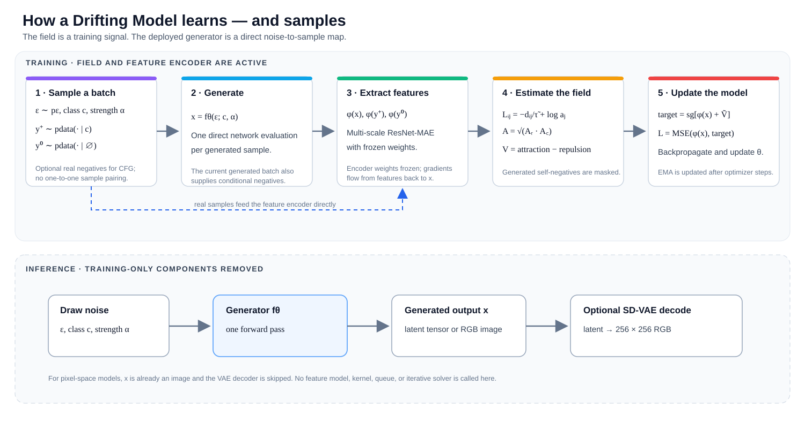
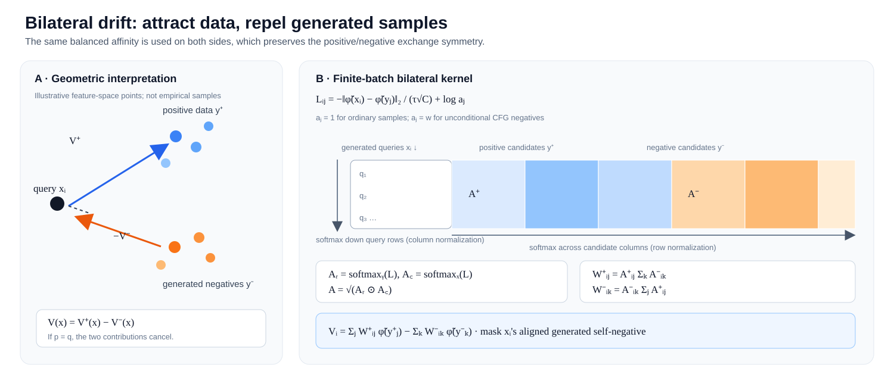
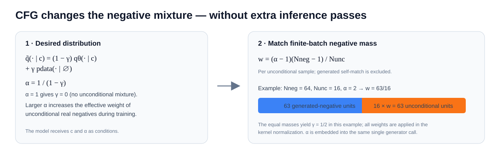

# Latent Drifting Foundation Model Framework

An implementation framework for **Drifting Models**, following Deng et al., [*Generative Modeling via Drifting*](https://arxiv.org/abs/2602.04770v2). It learns a direct noise-to-sample map and uses a data-dependent drift field during training to move generated samples toward the data distribution. Sampling uses one generator forward pass; it does not run a diffusion/ODE sampling loop.

> The paper is the scientific reference. The FID numbers it reports are not results produced or independently reproduced by this repository. See [the implementation plan](docs/IMPLEMENTATION_PLAN.md) for scope, staged milestones, and known deployment limits.

## The method at a glance



Training compares generated samples with same-class real positives and (optionally) real unconditional negatives. A frozen feature encoder supplies differentiable representations; a bilateral kernel estimates a drift in those features; and the generator is optimized toward a stop-gradient drifted target. The feature encoder and drift calculation are training-only. The inference artifact contains the generator and, for latent generation, a reference to the VAE decoder.

## Mathematical formulation

### 1. Learn a pushforward distribution

Let $\epsilon\sim p_\epsilon$ be a random input and let $f_\theta$ be a neural generator. Its output and induced distribution are

$$
x=f_\theta(\epsilon;c,\alpha),\qquad q_\theta(\cdot\mid c,\alpha)=[f_\theta(\cdot;c,\alpha)]_p_\epsilon.
$$

Here $c$ is an optional class condition, $\alpha\geq1$ is the training-time guidance condition, and $[f]_{\#}p$ denotes the distribution obtained by mapping samples from $p$ through $f$. The aim is to make the conditional pushforward $q_\theta$ match the corresponding data distribution $p_{\mathrm{data}}(\cdot\mid c)$.

Unlike a diffusion sampler, the model does not repeatedly transform a sample at inference. Instead, optimization changes $\theta$ over training steps, thereby changing the entire pushforward distribution.

### 2. Define a field that attracts and repels

For a generated query $x$, draw a positive $y^+\sim p$ and a negative $y^-\sim q$. A similarity kernel $k(x,y)$ gives more influence to nearby samples. The normalized positive and negative mean-shift vectors are

$$
V_p^+(x)=\frac{\mathbb E_{y^+\sim p}[k(x,y^+)(y^+-x)]}{Z_p(x)},\qquad
Z_p(x)=\mathbb E_{y^+\sim p}[k(x,y^+)],
$$

$$
V_q^-(x)=\frac{\mathbb E_{y^-\sim q}[k(x,y^-)(y^--x)]}{Z_q(x)},\qquad
Z_q(x)=\mathbb E_{y^-\sim q}[k(x,y^-)].
$$

The drifting field is the difference between attraction to data and repulsion from generated samples:

$$
V_{p,q}(x)=V_p^+(x)-V_q^-(x)
=\frac{\mathbb E_{p,q}\!\left[k(x,y^+)k(x,y^-)(y^+-y^-)\right]}{Z_p(x)Z_q(x)}.
$$

Swapping the positive and negative distributions reverses the sign, $V_{p,q}(x)=-V_{q,p}(x)$. In particular, if $p=q$, then $V_{p,p}(x)=0$: attraction and repulsion cancel. This establishes the desired equilibrium direction. It does **not** claim that every possible zero-drift field uniquely proves $p=q$; the paper discusses additional identifiability conditions separately.



### 3. Estimate the field with a bilateral batch kernel

For a feature vector with channel dimension $C$, let $d_{ij}=\|\tilde\phi(x_i)-\tilde\phi(y_j)\|_2$. The normalized feature kernel uses temperature $\tau$:

$$
L_{ij}=-\frac{d_{ij}}{\tau\sqrt C}+\log a_j,
$$

where $a_j$ is the candidate's nonnegative sample weight (normally 1; unconditional CFG candidates use weight $w$). A zero-weight candidate has logit $-\infty$. If a generated sample is also a negative, its aligned self-comparison is masked from the logits.

The implementation normalizes each logit in both directions. For query index $i$ and candidate index $j$,

$$
A^{\mathrm{row}}_{ij}=\mathrm{softmax}_{j}(L_{ij}),\qquad
A^{\mathrm{col}}_{ij}=\mathrm{softmax}_{i}(L_{ij}),\qquad
A_{ij}=\sqrt{A^{\mathrm{row}}_{ij}A^{\mathrm{col}}_{ij}}.
$$

The row softmax distributes each query across candidates; the column softmax also balances how much each candidate is used across the query batch. Their geometric mean is the bilateral affinity. Split $A$ into positive and negative blocks, $A^+$ and $A^-$. For query $x_i$, the cross-mass weights and finite-batch field are

$$
W^+_{ij}=A^+_{ij}\sum_k A^-_{ik},\qquad
W^-_{ik}=A^-_{ik}\sum_j A^+_{ij},
$$

$$
V_i=\sum_j W^+_{ij}\,\tilde\phi(y_j^+)-\sum_k W^-_{ik}\,\tilde\phi(y_k^-).
$$

These cross-mass factors preserve the positive/negative exchange symmetry. The implementation computes the two-axis normalization in log space and in chunks: a first pass accumulates column log-normalizers, then a second pass forms the affinities and field. This bounds peak distance-matrix memory without replacing the global batch normalization with a chunk-local approximation.

### 4. Move predictions toward a detached fixed point

The paper's basic fixed-point target is the current output plus its estimated field. For a feature map $\phi_j$, define the detached target

$$
t_j(x)=\mathrm{stopgrad}\!\left(\tilde\phi_j(x)+\tilde V_j(x)\right).
$$

The multi-feature objective is

$$
\mathcal L(\theta)=\sum_j\mathrm{MSE}\!\left(\tilde\phi_j(f_\theta(\epsilon)),\ t_j(f_\theta(\epsilon))\right).
$$

The target is held fixed during backpropagation. Consequently the kernel, pairwise distances, and drift are not differentiated through; gradients flow through the prediction branch and the feature operations back to the generated sample and generator parameters. The feature encoder's parameters stay frozen, but its input Jacobian is retained. Numerically, each MSE term equals the mean squared normalized drift for that batch; its **gradient** is the fixed-target regression gradient, not the derivative of a differentiable kernel objective.

### 5. Normalize feature scales and combine temperatures

Different feature stages can have very different magnitudes and channel counts. For feature group $j$ with $C_j$ channels, the paper sets a scalar feature scale so the expected normalized pair distance is on the order of $\sqrt{C_j}$:

$$
S_j=\frac{1}{\sqrt{C_j}}\,\mathbb E_{x,y}\left[\|\phi_j(x)-\phi_j(y)\|_2\right],\qquad
\tilde\phi_j(x)=\frac{\phi_j(x)}{S_j}.
$$

The code estimates the expectation over the current batch, weights unconditional examples by their CFG weight, and smooths the estimate with the configured exponential moving average $S_j^{(t)}=\rho S_j^{(t-1)}+(1-\rho)S_{j,\mathrm{batch}}$. Its kernel denominator is therefore $\tau\sqrt{C_j}$, matching the paper's dimension-normalized temperature.

For a raw per-temperature field $V_{j,\tau}$, define

$$
\lambda_{j,\tau}=\sqrt{\mathbb E\!\left[\frac{\|V_{j,\tau}\|_2^2}{C_j}\right]},\qquad
\tilde V_{j,\tau}=\frac{V_{j,\tau}}{\lambda_{j,\tau}}.
$$

The package estimates this RMS scale over the current batch (with an epsilon floor). It computes a separately normalized field for each configured temperature and sums them before forming the target:

$$
\tilde V_j=\sum_{\tau\in\mathcal T}\tilde V_{j,\tau},\qquad
\mathcal T=\{0.02,\ 0.05,\ 0.2\}\quad\text{by default}.
$$

### 6. Classifier-free guidance as a negative-mixture weight

For a class $c$, the desired effective negative distribution is a mixture of same-class generated samples and real unconditional samples:

$$
\tilde q(\cdot\mid c)=(1-\gamma)q_\theta(\cdot\mid c)+\gamma p_{\mathrm{data}}(\cdot\mid\varnothing),\qquad
\alpha=\frac{1}{1-\gamma}.
$$

The paper's target relation is $q_\theta=\alpha p_{\mathrm{data}}(\cdot\mid c)-(\alpha-1)p_{\mathrm{data}}(\cdot\mid\varnothing)$. In a finite batch, each generated query excludes itself, leaving $N_{\mathrm{neg}}-1$ generated negatives. If there are $N_{\mathrm{unc}}$ unconditional negatives and each receives kernel weight $w$, matching the desired mixture gives

$$
\alpha=1+\frac{N_{\mathrm{unc}}w}{N_{\mathrm{neg}}-1}
\quad\Longrightarrow\quad
w=\frac{(\alpha-1)(N_{\mathrm{neg}}-1)}{N_{\mathrm{unc}}}.
$$

For example, $N_{\mathrm{neg}}=64$, $N_{\mathrm{unc}}=16$, and $\alpha=2$ imply $w=63/16$. The same weight is used for the unconditional candidates in the kernel and feature-distance normalization. The class label and $\alpha$ are both inputs to the generator; changing $\alpha$ at inference does not require a second conditional/unconditional forward pass.

The configurable `power` sampler draws from a truncated density proportional to $\alpha^{-p}$ on `[alpha_min, alpha_max]` (with a log-uniform special case for $p=1$). Configurations may instead request uniform sampling or the fixed value $\alpha=1$.



## Feature representation used by this package

The latent-MAE encoder is a GroupNorm ResNet-style network. It emits multiscale feature maps; for each map the descriptor builder creates independent feature groups for:

- every spatial location;
- per-channel global mean and standard deviation;
- per-channel means and standard deviations pooled over 2×2 and 4×4 regions;
- the input's per-channel mean-square statistic, $\mathbb E_{h,w}[x^2]$.

Each group gets its own feature normalization, bilateral kernel, per-temperature field, and MSE term. The pixel adapter first converts each 8×8 RGB patch to a 192-dimensional vector on a 32×32 grid, so the same ResNet-style encoder can operate at that grid. The generator objective can also be used with other mappings that return `[batch, descriptors, channels]` feature tensors. The current default trainer uses these descriptor groups; it does not add a separate identity/raw-output feature group in addition to them.

For MAE pretraining, the implemented reconstruction objective is masked-region squared error:

$$
\mathcal L_{\mathrm{MAE}}=\frac{\sum_{b,c,h,w}m_{b,h,w}(\hat x_{b,c,h,w}-x_{b,c,h,w})^2}
{C\sum_{b,h,w}m_{b,h,w}},
$$

where $m$ selects masked patches. Classifier fine-tuning uses $\mathcal L_{\mathrm{ft}}=(1-\lambda)\mathcal L_{\mathrm{recon}}+\lambda\mathcal L_{\mathrm{cls}}$; $\lambda$ warms up from 0 to 0.1 and is then held at 0.1 by the default recipe.

## What one training update does

For each class group, the training loop follows this sequence:

1. Sample a class $c$, a guidance value $\alpha$, and Gaussian input noise $\epsilon$ (plus optional discrete style codes).
2. Draw $N_{\mathrm{pos}}$ real positives from class $c$, and optionally $N_{\mathrm{unc}}$ real examples for unconditional negatives.
3. Evaluate $x=f_\theta(\epsilon;c,\alpha)$. Generated samples are also the conditional negative set; each query's aligned self-negative is excluded.
4. Extract features for generated, positive, and unconditional samples. Freeze feature-encoder weights while preserving gradients from generated features to $x$.
5. Estimate per-feature bilateral drifts at each configured temperature, normalize them, and form the detached targets.
6. Sum feature MSE terms, backpropagate, clip gradients, and update $\theta$. Update configured EMA copies after optimizer steps.

The effective generated batch per optimizer update is

$$
B_{\mathrm{generated}}=N_c\,N_{\mathrm{neg}}\,N_{\mathrm{accum}},
$$

where $N_c$ is the configured global class allocation, $N_{\mathrm{neg}}$ generated samples are used per class per microbatch, and $N_{\mathrm{accum}}$ is gradient accumulation. Positive examples are grouped by class and need not be paired with a generated sample.

## Generator and inference path

The generator maps noise, class, and guidance directly to one output:

$$
f_\theta:(\epsilon,c,\alpha)\longmapsto x.
$$

The reference latent route uses a 32×32×4 SD-VAE latent and a DiT/2 patch embed, producing 16×16 = 256 spatial tokens. Pixel variants use 256×256×3 tensors and DiT/16, also producing 256 spatial tokens. Configurable variants use RMSNorm, QK normalization, SwiGLU, 2D RoPE, adaLN-Zero conditioning, and 16 learned register tokens. The optional style-noise path samples 32 codebook indices and adds their scaled embedding sum to the condition vector; these codes do not increase sequence length.

At inference, draw one $\epsilon$, supply $(c,\alpha)$, and evaluate the generator once. For latent generation, decode the resulting latent with the configured VAE to obtain RGB. The feature encoder, bilateral kernel, optimizer, queues, and training targets are not required by the deployment artifact.

## Install

Use Python 3.10 or later and install a PyTorch build suited to the host's OS and accelerator, then install the package:

```powershell
python -m pip install torch
python -m pip install -e .
```

Optional VAE, metric, and export dependencies:

```powershell
python -m pip install -e ".[vae,metrics,export]"
```

For the workspace's Python 3.15 interpreter, PyTorch 2.14 provides Python 3.15 wheels through the official PyTorch wheel index; use the correct CPU/CUDA/ROCm/XPU index for the machine. Python 3.15 support in PyTorch 2.14 is eager-only: `torch.compile` is not supported there. See the [official PyTorch 2.14 release notes](https://pytorch.org/blog/pytorch-2-14-release-blog/) and [installation selector](https://pytorch.org/get-started/locally/).

## End-to-end workflow

1. Edit a versioned configuration under `configs/`.
2. Cache latents: `latent-drifting cache-latents --config configs/ablation_b2.yaml`.
3. Pretrain the latent MAE: `latent-drifting train-mae --config configs/ablation_b2.yaml`.
4. Train the generator with DDP: `torchrun --nproc_per_node=8 -m latent_drifting.cli.train_generator --config configs/ablation_b2.yaml --mae-checkpoint runs/ablation-b2/latent-mae.pt`.
5. Export EMA weights: `latent-drifting export --config configs/ablation_b2.yaml --checkpoint runs/ablation-b2/last.pt --ema-decay 0.9999 --output artifacts/drifting.pt`.
6. Sample: `latent-drifting sample --artifact artifacts/drifting.pt --count 16 --class-id 207`.
7. Compute real validation statistics: `latent-drifting compute-real-stats --root data/imagenet/val --count 50000 --output evaluation/imagenet-val.npz`.
8. Evaluate a fixed-seed set: `latent-drifting evaluate --artifact artifacts/drifting.pt --real-stats evaluation/imagenet-val.npz --count 50000 --output evaluation/run-001`.

For pixel-space training, use `configs/production_pixel_b16.yaml`, skip latent caching, and pretrain the feature MAE with `python -m latent_drifting.cli.train_mae --config configs/production_pixel_b16.yaml --pixel`. Continue with the generator command using that pixel config and its pixel MAE checkpoint. Use a held-out validation folder for real statistics; do not compute FID reference statistics from the training split.

## Implementation notes and limits

- `data.num_classes` defaults to 1,000; `batch.classes` is the number of classes allocated to a training step, not the dataset class count.
- The package includes B/2 and L/2 latent configs and B/16 pixel configuration examples. Paper-reported results—FID 1.54 for latent and 1.61 for pixel ImageNet 256×256—are reference results, not benchmarks from this repository.
- The training CLI reads grouped samples from the latent cache or image dataset. FIFO sample-queue components are included for queue-driven integrations, but are not the default CLI data source.
- DDP is the end-to-end multi-GPU training path. The FSDP wrapper is a lower-level integration hook; the trainer intentionally rejects FSDP until sharded EMA and full-state checkpoint handling are integrated.
- Generator checkpoints restore sampler epoch/offset and per-rank RNG state. MAE checkpoints restore model, optimizer, EMA, and RNG, but not the exact shuffled DataLoader position inside an epoch.
- This workspace has not run the training/evaluation workflows; install a compatible PyTorch build and follow the staged validation plan before treating an experiment as reproduced or production-qualified.

## References

- Deng, M., Li, H., Li, T., Du, Y., and He, K. (2026). [*Generative Modeling via Drifting*, arXiv:2602.04770v2](https://arxiv.org/abs/2602.04770v2).
- See [docs/IMPLEMENTATION_PLAN.md](docs/IMPLEMENTATION_PLAN.md) for implementation phases, validation gates, and operational safeguards, and [docs/MODEL_CARD.md](docs/MODEL_CARD.md) for intended use and limitations.
